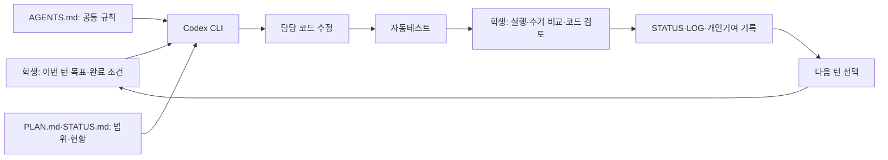

# 11월 6일 개인별 중간 제출과 단계별 개발 계획

작성 기준: 2026-11-02. 개발 환경은 WSL Ubuntu, 최종 실행은 Windows다. 실제 전체 구현은 조재민이 진행하고 과제의 부분주제 구분 및 개인 기여는 실제 활동과 구분해 기록한다. 시작 절차는 [WSL·Windows 실행 안내](WSL_WINDOWS_GUIDE.md)를 따른다.

## 제출 조건

| 구분 | 확인한 조건 |
|---|---|
| 중간 결과물 | 2026-11-06(금) 23:59까지 코드 개인별 ZIP 제출 |
| 파일명 | 중간결과물_학번_이름_진행률%.zip |
| 진행률의 분모 | 전체 프로젝트에서 본인이 담당한 전체 작업 |
| 진행률의 분자 | 그중 실제 구현·작업을 완료한 부분 |
| 최종 제출 | 2026-12-04(금) 23:59, PPT 10매 이상·최종 코드·회의록 8회 이상 |
| 최종 발표 | 2026-12-09, 개인당 3분·질의응답 1~2분 정도 |

출처: 사용자가 2026-11-02 제공한 [전체 프로젝트 공지](https://canvas.ssu.ac.kr/courses/48498/discussion_topics/227145)와 [중간결과물 과제 화면](https://canvas.ssu.ac.kr/courses/48498/assignments/747230?module_item_id=3425578). 중간 과제 화면은 코드 ZIP 업로드를 요구하며 PPT·발표 영상 제출 요구는 보이지 않는다. 사용자가 말한 코드 발표는 준비하되, 최종 제출물 규격과 구분한다.

## 과제의 부분주제와 개인별 제출 초점

| 담당 | 전체 담당 범위 | 중간 제출에서 보여줄 코드 | 최종까지 남길 작업 |
|---|---|---|---|
| 조재민 | 입력·인식 | 웹캠 입력, 눈 좌표·EAR 계산, 얼굴 검출 상태, C 전달, 좌표 표시·수치 기록 | 조명·안경·각도별 입력 안정화, 실제 조건별 검증, 처리 속도와 오류 처리 |
| 김재원 | C 판정·집계·알림 | 상태 전이, 깜빡임 1회 집계, 60초 배열 관리, 기준 미달·대기 시간, 기본 알림 연결 | 경계 상황과 오탐·누락 개선, 설정·일시정지·알림 사용성, 반복 검증 |

위 표는 과제에서 나눈 부분주제다. 현재 개발은 조재민이 두 영역을 통합 구현하는 방식으로 진행한다. 김재원의 실제 검토·실험·수정 활동은 수행한 뒤 기록한다. 공통 인터페이스는 blink_engine.h와 engine.py이며, 기존 코드의 작성자를 부분주제 표만으로 소급해 배정하지 않는다.

## 이번 제출의 권장 수준

전체 기능 구현을 우선 진행하고, 중간 제출은 해당 시점의 실행 가능한 코드 버전으로 남긴다. 개인별 제출에는 실제로 수행한 검토·구현·검증 내용을 기록한다. 조건별 반복 검증·오류 개선·사용성·다른 환경 재현은 확인한 상태에 따라 완료 또는 남은 작업으로 표시한다.

실제 진행률은 CONTRIBUTIONS.md의 작업표와 검증 근거로 제출 직전에 계산한다. 현재 자료만으로 두 사람의 개인 진행률을 확정할 수는 없다. 40~60%에 맞추려고 기능을 제거하지 않으며 알려진 결함과 미검증 항목을 정확히 표시한다.

## 개인별 ZIP 구성 제안

```text
중간결과물_실제학번_본인이름_실제진행률%.zip
├─ README.md                 실행 방법·현재 한계·본인 담당 안내
├─ 개인기여.md               실제 담당 파일/함수·수정·검증·진행률 근거
├─ source/                   같은 시점의 공통 실행 소스와 필요한 설정
├─ verification/             자동테스트 결과·실제 수행한 비교 기록
└─ development/              관련 턴 프롬프트·실행 기록·남은 작업
```

공통 소스를 포함해 각 ZIP만으로 실행 가능하게 구성하는 것을 권장한다. 학번·허용 업로드 용량은 실제 정보를 입력한다. 가상환경, 캐시, 수업 연습 코드, 관계없는 영상은 제외한다. 모델·라이브러리는 포함 여부와 준비 방법을 실행 안내에 명시한다. ZIP 두 개의 개인기여.md와 검증 설명은 각자의 실제 작업에 맞게 작성한다.

## MD 파일 구조

```text
프로젝트/
├─ AGENTS.md
├─ 기존 소스·README.md
└─ 개발관리/
   ├─ README.md              제출 조건·역할·구성
   ├─ PLAN.md                턴별 목표·담당·완료 조건
   ├─ STATUS.md              지금 확인된 동작·실패·미검증 항목
   ├─ PROMPTS.md             다음 턴에 사용할 지시문
   ├─ CONTRIBUTIONS.md       개인별 기여와 진행률 산정표
   ├─ DEVELOPMENT_LOG.md      실제 수행한 턴과 검증 기록
   └─ WSL_WINDOWS_GUIDE.md    WSL 시작·Windows 검증·GitHub 연결 절차
```

AGENTS.md는 Codex가 읽는 프로젝트 지침이다. 나머지 파일은 이 팀이 정한 관리 방식이며 프롬프트에서 읽도록 지정한다. 문서 자체가 프로그램 실행에 필요한 것은 아니다. 참고: [OpenAI AGENTS.md 문서](https://learn.chatgpt.com/docs/agent-configuration/agents-md), [단계별 개발 기록 예시](https://developers.openai.com/cookbook/examples/codex/iterating-development-workflows-with-codex).

## 최종 발표에서 보여줄 구조도



개발 방식 소개에서는 위 흐름을 짧게 보여주고, 대표 사례 하나를 실제 프롬프트 → 변경한 코드 → 테스트·실험 → 판단 순서로 설명한다. 실패 후 수정한 사례도 근거가 된다. 현재 문서는 앞으로 사용할 구조이며, 과거에 Codex CLI로 수행했다고 소급해 설명하지 않는다.
