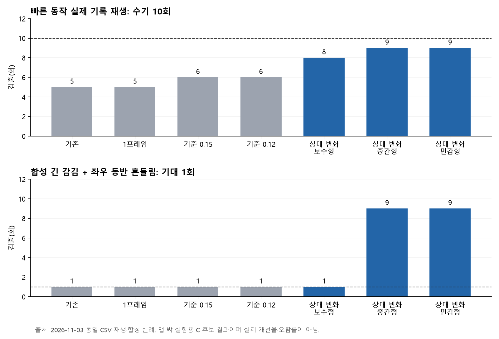

# 보수형 후보는 빠른 기록을 5회에서 8회로 늘렸으나 10회 목표에는 미달했다

기준일: 2026-11-03. 사용자 ‘그러면 진행해’ 요청으로 RAPID_BLINK_PLAN의 T08-A만 수행했다. 실험용 C 라이브러리를 별도 경로에 빌드해 같은 EAR 입력을 재생했다. 현재 실행 앱·판정·DLL·설정과 원본 CSV는 유지했다. T08-B 실제 반영과 T08-C 새 카메라 실험은 수행하지 않았다.

## 비교 결과

수기 보고는 평소 10회, 빠른 두 번 5묶음=개별 10회다. 아래 실제 기록 결과는 같은 두 CSV의 재생 결과이며 새 촬영 결과가 아니다.

| 후보 | 설정·방법 | 평소 기록 | 빠른 기록 | 합성 동반 잡음이 있는 긴 감김(기대 1회) | 기존 24개 회귀 | 추가 15개 조건 |
|---|---|---:|---:|---:|---|---|
| 기준 | 감김 0.18·열림 0.23·2프레임 | 10회 | 5회 | 1회 | 통과 | 짧은 재개방 5조건 미충족 |
| A_one_frame | 기존 문턱값·1프레임 | 10회 | 5회 | 1회 | 실패 항목 15건 | 6조건 미충족 |
| A_lower_015 | 감김 0.10·열림 0.15·2프레임 | 10회 | 6회 | 1회 | 통과 | 짧은 재개방 5조건 미충족 |
| A_lower_012 | 감김 0.10·열림 0.12·2프레임 | 10회 | 6회 | 1회 | 통과 | 통과 |
| B_conservative | 양쪽 상승/하강 최소 0.06, 상승값 바닥 0.08 | 10회 | **8회** | **1회** | **통과** | **통과** |
| B_moderate | 양쪽 상승/하강 최소 0.04, 상승값 바닥 0.06 | 10회 | 9회 | **9회** | 통과 | 동반 잡음 조건 실패 |
| B_sensitive | 양쪽 상승/하강 최소 0.02, 상승값 바닥 0.03 | 10회 | 9회 | **9회** | 통과 | 작은 잡음·동반 잡음 2조건 실패 |

회귀의 실패 항목 수는 서브테스트를 포함하므로 실패 메서드 수와 같지 않다. 문턱값 후보 A의 기본값은 명시 설정이 없는 테스트 생성자에 적용했으며, 앱 모의 테스트의 명시 CLI 기본값·사용자 정의 문턱값은 유지했다. 따라서 ‘24개 통과’를 모든 변경 설정에서의 앱 실행 보증으로 표현하지 않는다. 후보별 로그에 적용 범위를 명시했다. B는 공개 기본값·구조체 배치와 기존 입력을 유지한 C 분기 추가안이다.

## 비교한 규칙

### A: 기존 조건 변경 대조안

프레임 확인을 1개로 낮춰도 실제 빠른 기록은 5회 그대로였고 기존 순간 잡음·연속 확인 기대를 깨뜨렸다. 이 기록은 프레임 수만 바꾸는 것으로 해결되지 않는다.

열림·감김 문턱값을 낮추는 두 안은 6회로 증가했다. 여전히 목표에 미달했고 보수형 B보다 회복하는 사건 후보가 적어 우선안으로 선택하지 않았다. 새 기본값으로 적용하지 않았다.

### B: 감긴 상태 중 상승·재하강 확인

실험용 분기는 확정 CLOSED 동안 좌우 최저값을 추적하고, 양쪽이 충분히 함께 상승한 상태를 2프레임 확인한다. 이후 양쪽이 충분히 하강해 다시 감긴 후보가 2프레임 확인되면 짧은 재개방 뒤 다음 감김으로 보고 추가 이벤트 1개를 확정한다. 마지막 완전 재개방에서는 기존 이벤트를 집계한다.

공통 실험 조건은 첫 감김 확인 후 최소 50ms, 구간 최대 900ms, 재상승 후보 시작 뒤 재감김 결정까지 최대 400ms다. 모두 비교를 위한 공학적 후보값이며 의학적 시간 기준이 아니다. 새 기본 설정으로 확정하지 않았다.

- 이벤트는 결정된 입력 프레임의 유효 시각으로 저장한다. 과거의 상승 시점으로 배열 시각을 소급하지 않는다.
- 한 입력에서 blink는 0 또는 1만 반환한다. 완전 열림 분기와 추가 분기가 같은 프레임에서 중복 집계되지 않게 했다.
- 미검출·무효 EAR·긴 공백·OPEN 복귀에서 임시 추적을 끊는다. C의 기존 배열·유효 시간·알림 처리를 사용한다.
- 코드·매크로·컴파일 명령·DLL을 각 후보 폴더에 보관했으며 현재 앱은 이를 로드하지 않는다.

## 우선 검증 후보: B_conservative

현재 확인한 후보 중 평소 10회를 유지하면서 실제 빠른 기록의 차이를 줄이고 시험한 반례를 통과한 것은 보수형 B다. **기본 앱 채택 확정이 아닌 다음 단계의 우선 검증 후보**로 제안한다. 목표 10회 중 여전히 총횟수 차이 −2회가 남는다.

추가 이벤트의 결정 시각(빠른 기록 경과 시간)은 다음과 같다.

| 결정 시각 | 후보가 사용한 근거 |
|---:|---|
| 3.001226초 | 앞선 양쪽 EAR 상승 뒤 두 번째 하강을 확인해 추가 1회 |
| 4.167883초 | 양쪽 상승·재감김 조건을 확인해 추가 1회 |
| 6.252167초 | 양쪽 상승·재감김 조건을 확인해 추가 1회 |

기존 완전 열림 이벤트 5개는 유지됐다. 각 파일의 프레임별 EAR·상태·결정 이유와 이벤트 시각을 candidates/B_conservative에 보관했다. 사건별 실제 영상 시점이 없어 이 추가 3개를 확정된 실제 정답 검출로 분류하지 않는다.

민감한 후보는 9회까지 세지만 한 번의 긴 감김에 작은/동반 흔들림을 넣은 합성 반례에서 9회로 잘못 나눴다. 총횟수를 10에 더 가깝게 만드는 이유만으로 이를 선택하지 않는다.

## 추가 검증과 정보 한계

추가 조건은 15개다: 단일·뚜렷한 이중/삼중 동작, 일정한 긴 감김, 작은/동반 잡음, 한쪽 상승·윙크, 미검출·무효 입력 단절, 한 프레임 열림 잡음, 부분 상승 후 정상 열림 중복 방지, 16/33/67ms 간격의 같은 시간 파형. 각 경우 blink가 0/1 범위인지, 유효 시각의 이벤트 수와 최근 60초 집계가 일치하는지, 이후 유효 60초가 지나면 만료되는지도 확인했다. 합성 간격을 실제 카메라 FPS로 표시하지 않는다.

별도 모호성 탐색 1개는 같은 EAR 파형을 ‘실제 짧은 재개방 두 번’과 ‘한 번 감긴 동안 큰 좌표 흔들림’이라는 두 물리 상황으로 해석할 수 있음을 보여준다. 기대값을 동시에 만족해야 하는 불가능한 통과 조건으로 만들지 않았다. 보수형도 이 파형을 2회로 세므로 입력만 같으면 실제 원인을 구분할 수 없다. 일부 합성 잡음 통과를 일상 오탐이 없다는 보증으로 사용하지 않는다.

초기 비교에서 A_lower_012의 단절 테스트를 단순 최종 0회로 평가했다가 검사 기준을 수정했다. 낮아진 열림 기준에서는 단절 전에 이미 유효한 첫 이벤트가 확정될 수 있으므로, 보호 조건은 **단절 이후 새 연결 이벤트 없음·이전 유효 기록 유지**여야 한다. 기존 24개 테스트는 바꾸지 않았으며 처음 스크립트·결과도 initial 파일로 보존했다. 결과를 좋게 만들기 위해 무효 입력 정책을 완화한 것이 아니다.

개인별 열린 값에 대한 후보 C는 이번에 구현하지 않았다. 기존 자료에서 중간 값이 매우 낮은 구간의 진짜 움직임을 확인하지 못한 상태에서 적응 기준까지 추가하는 것은 범위·오탐 위험이 커져 후속 검토로 남겼다.

## 보존·환경·재현

v01 저장소에는 실제 웹캠 원본·프레임별 재생 CSV를 포함하지 않는다. 재현 시 원본 CSV/JSON을 로컬 data/records 또는 이 폴더의 inputs에 준비해야 하며 스크립트가 보존 해시와 일치를 확인한다. 재현 스크립트는 baseline의 소스·테스트를 import하므로 프로젝트 README/VERSION이 이후 바뀌어도 보존한 실험 버전으로 비교한다. 최초 스크립트(initial)는 검사 수정 이력 보관용이다.

- baseline에 실제 기존 소스·설정 15개, inputs에 CSV·JSON 4개와 SHA256을 보존했다.
- [원본 보존 목록](baseline_manifest.json), [전체 비교 결과](comparison_results.json), [최종 무결성·제안](integrity_and_decision.json).
- [재현 스크립트](compare_candidates.py). 실행 명령: 프로젝트 `.venv` Python으로 이 스크립트를 실행한다. Windows용 DLL과 현재 연결 테스트를 사용하는 Windows 실험 도구다.
- 각 candidates/후보명에 실험 C·헤더·브리지, build.log, regression.log, result.json, 실제 기록별 결정 CSV를 보관했다.
- Windows Python 3.13.9 AMD64 64비트·gcc x86_64-w64-mingw32에서 경고를 오류로 처리(-Wall -Wextra -Werror)해 7개 DLL 빌드 성공. WSL은 E_ACCESSDENIED로 Linux 결과 없음.
- 비교 전후 현재 소스 15개와 원본 입력 4개 해시 일치. 현재 앱 DLL도 사용자 빠른 세션의 JSON에 기록된 DLL 해시와 일치한다. 사용자 프로세스 종료·현재 DLL 재빌드·Git 커밋/태그/원격 변경 없음.

## 다음 단계

T08-A 비교는 완료했다. T08-B에서는 보수형을 검증용 후보로 실제 엔진에 옮길지 검토하고, 추가 결정 사유·시점 추적을 유지한 채 기존/추가 회귀를 확인해야 한다. 10회 목표를 달성했다고 선언하거나 이번에 기본 앱을 바꾸지 않는다.

실제 채택 전에는 별도 실행과 사건별 시점 근거로 추가 3개가 실제 깜빡임인지 확인해야 한다. 남은 두 동작은 상대 상승이 작거나 짧은 구간의 정보가 부족해, 더 민감하게 세는 것으로 해결된다고 보장할 수 없다. 새 자료를 조정용과 독립 평가용으로 구분하며 사용자 추가 실험 절차는 실제 검증 버전을 준비한 뒤 제시한다.
