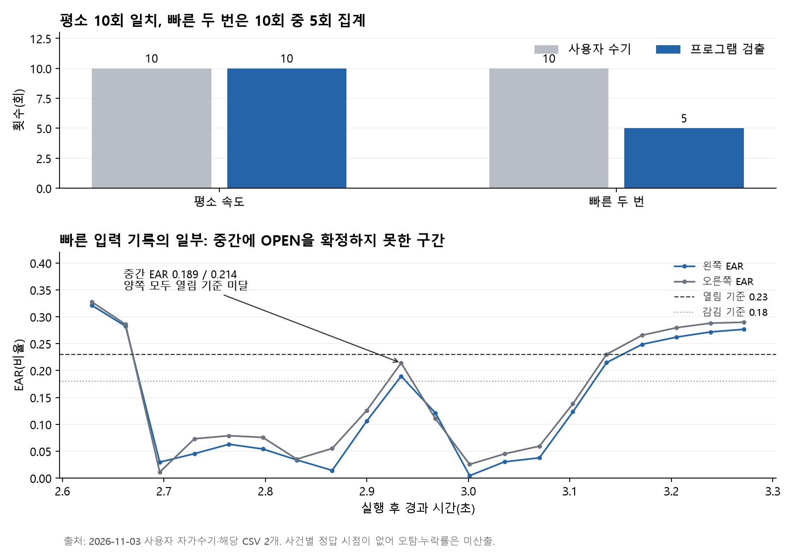

# 평소 속도는 수기 10회와 일치했고, 빠른 두 번은 5회로 집계됐다

기준일: 2026-11-03. 사용자 자가수기 보고와 같은 이름의 실제 웹캠 CSV·JSON을 비교했다. 참가자 신원·조명·안경·고개 각도의 정량 조건과 개별 실제 깜빡임 시점은 제공되지 않았다. 정해진 동작의 예비 비교이며 일상 사용 정확도나 일반적인 사용자 성능을 뜻하지 않는다.

| 항목 | 평소 속도 | 빠른 두 번 |
|---|---:|---:|
| 사용자 실제 횟수 보고 | 10회 | 10회(빠른 두 번 5묶음) |
| 프로그램 이벤트 합계 | 10회 | 5회 |
| 총횟수 차이(프로그램−자가수기) | 0회 | −5회 |
| 실행 경과 시간 | 27.354초 | 9.440초 |
| 유효 측정 시간 | 27.195초 | 9.250초 |
| 기록 프레임 | 820행 | 284행 |
| 기록 FPS 중앙값 | 29.863프레임/초 | 30.007프레임/초 |
| 프레임 간격 중앙값 | 33.843ms | 33.850ms |
| 최대 프레임 간격 | 122.835ms | 70.427ms |
| 얼굴 미검출 행 | 3행 | 6행 |
| 검출된 얼굴의 무효 EAR 행 | 0행 | 0행 |

두 세션 모두 감김 상한 0.18·열림 하한 0.23·연속 확인 2프레임·기준 12회·미달 지속 10초·재알림 60초다. 두 JSON에 기록된 앱·기록기·C/헤더·브리지 소스 해시가 현재 코드와 일치한다. 두 실행은 60초 미만이므로 이 파일에서 최근 60초 기록 만료가 이벤트 합계와 최종 횟수의 차이를 만든 것은 아니다. 알림 이벤트는 두 파일 모두 0회다.

## 기록에서 확인한 판정 동작

빠른 기록을 현재 문턱값으로 분류하면 양쪽이 함께 감긴 후보 구간은 7개이며 각 구간 길이는 4~12프레임이다. 단순히 모든 감김이 1프레임뿐이라 제외된 결과는 아니다. 일부 구간 사이에는 열림 후보가 아닌 중간값이 들어와 C의 CLOSED 상태가 유지됐다. 다른 구간은 감김 후보가 계속 이어졌다.

예를 들어 빠른 기록의 **프레임 89, 경과 2.933687초**에서 좌우 EAR은 약 **0.189/0.214**다. 감김 구간 사이에서 값이 올라왔지만 양쪽 모두 열림 기준 **0.23**에 미달해 OPEN 후보가 되지 않았다. 이어 다시 낮은 값이 들어왔고, 최종적으로 열린 상태가 확정된 프레임 97(3.205110초)에 1회를 집계했다.

또 다른 예인 프레임 123(4.067745초)은 약 0.202/0.239로 오른쪽만 열림 기준에 도달했다. 양쪽이 함께 기준을 만족하지 않아 OPEN을 확정하지 못했다. 사용자 보고의 빠른 두 번이 하나로 합쳐지는 동작과 부합하는 로그다.

빠른 세션의 미검출 6행은 전부 시작 프레임 1~6이고, 이후 감김 구간에서는 미검출·무효 EAR이 없었다. 실제 신호가 C의 열림 조건을 만족하지 않았다는 점은 확인했으나, 눈이 실제로 어느 정도 열렸는지와 영상 인식이 그 움직임을 얼마나 반영했는지는 사건별 수기 시점·영상 없이 구분할 수 없다. 30FPS 기록만으로 짧은 재개방의 샘플링 누락 가능성을 배제하지 않는다.

## 같은 기록의 재생 확인

각 CSV의 시각·EAR·유효성·설정을 현재 C에 다시 넣어 평소 820행·빠른 284행, 총 1104행의 blink·alert·state·최근 횟수·유효 시간·미달 시간·관측 유효성이 저장값과 모두 일치함을 확인했다. 실제 영상 재처리와 구분하며 앱 코드는 수정하지 않았다.

근거:

- 평소 CSV: `data/records/blink_20261103_114133_631762.csv`
- 빠른 CSV: `data/records/blink_20261103_114257_575690.csv`
- [평소 분석·파일 해시·검출 시각](normal_114133_analysis.json)
- [빠른 분석·파일 해시·후보 상태 구간](rapid_114257_analysis.json)
- [기록 입력 재생 결과](recorded_input_replay.json)

## 해석과 다음 단계

총횟수 일치를 정확도 100%로, 차이 −5회를 확정 누락률 50%로 쓰지 않는다. 개별 정답 시점이 없어 오탐과 누락의 상쇄 여부 및 개별 실제 동작 대응을 확인하지 못했다. 사용자 보고와 프로그램 총횟수의 차이로 기록한다.

다음 개선 검토는 이 두 CSV를 고정한 채 재생해 열림·감김 판정 대안이 평소 기록·기존 잡음/한쪽 눈/긴 감김 테스트에 주는 영향을 함께 확인하는 방식이다. 단순히 연속 확인을 1프레임으로 바꾸는 것만으로 중간 열림 값이 기준에 도달하지 않은 모든 구간을 해결할 수는 없다. 한 세션의 수기 총횟수 10에 맞춰 임의의 기준을 확정하지 않는다. 실제 동작의 시점 자료와 조정에 쓰지 않은 별도 실행으로 재검증한다.

이번 턴에는 분석·재생·기록만 수행했다. 판정 코드·설정값 변경, 새 카메라 실험, 커밋·태그·GitHub 작업은 하지 않았다.
